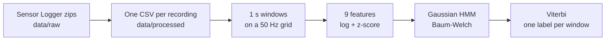
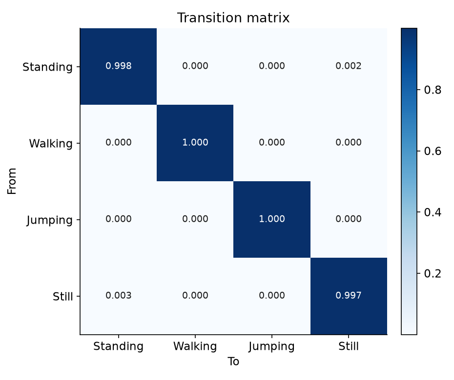
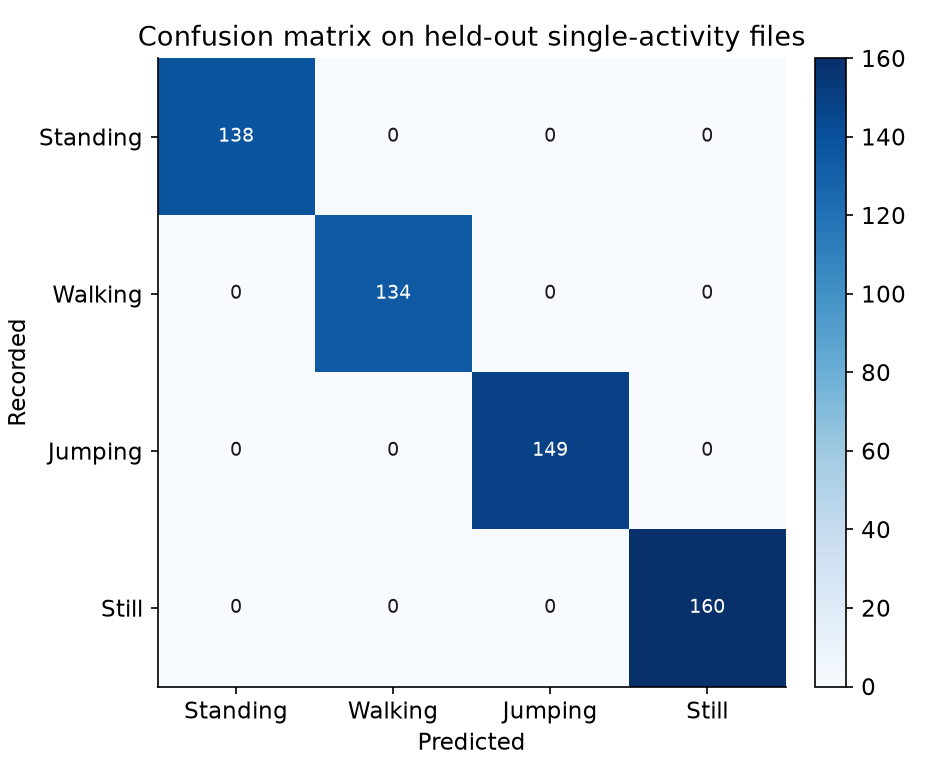

<!-- prettier-ignore -->
<div align="center">

# Activity recognition with a hidden Markov model

[](https://www.python.org)
[](src/hmm.py)
[](notebooks/hmm_activity_recognition.ipynb)
[](data/README.md)
[](#results)

Tell standing, walking, jumping, and still apart from a phone's accelerometer and gyroscope, with a Gaussian hidden Markov model written from scratch in NumPy.

[Overview](#overview) • [Results](#results) • [Getting started](#getting-started) • [Data](#data) • [How it works](#how-it-works) • [Project structure](#project-structure)


</div>

Formative 2 for Machine Learning Techniques at African Leadership University. The full write-up is in the [report](report/Formative_2_Hidden_Markov_Models.docx), and the [notebook](notebooks/hmm_activity_recognition.ipynb) runs every step with its output saved.

> [!NOTE]
> All 200 recordings come from one person, one phone, and one session. The perfect held-out score shows that the four activities are separable in this data, not that the model transfers to another person or another way of carrying the phone.

## Overview

A phone at the waist, or left on a desk, streams acceleration and rotation, but the activity behind that stream is hidden. This project treats the activity as the hidden state of an HMM and one-second windows of sensor features as its observations, then decodes the most likely activity for every window.



### Features

- **HMM from scratch.** Forward-backward in log space, Baum-Welch with a log-likelihood convergence test, and Viterbi decoding, checked by a self-test on a chain with known parameters.
- **Time and frequency features.** Magnitude statistics, signal magnitude area, axis correlation, FFT peak frequency, and spectral energy for every window.
- **Scaling that suits the data.** The size features span seven orders of magnitude, so they are log-scaled before the z-score, which keeps standing and still apart.
- **Real recordings.** 200 Sensor Logger exports and a converter that turns them into labelled CSVs and a manifest.
- **One command to reproduce.** `python -m src.experiment` refits the model and rewrites every figure and metric.

## Results

The model trains on 160 recordings and is tested on 40 it has never seen, 581 one-second windows in all.

| Activity | Test windows | Sensitivity | Specificity | Accuracy |
| --- | ---: | ---: | ---: | ---: |
| Standing | 138 | 1.000 | 1.000 | 1.000 |
| Walking | 134 | 1.000 | 1.000 | 1.000 |
| Jumping | 149 | 1.000 | 1.000 | 1.000 |
| Still | 160 | 1.000 | 1.000 | 1.000 |

<p align="center">
  
  
</p>

The transition matrix is nearly diagonal because every recording holds a single activity, so the training data contains no real changes of activity. Standing and still are the hard pair: both keep the phone flat, and only about 0.1 m/s² of sway separates one from the other's 0.01 m/s² of sensor noise.

> [!TIP]
> Without the log scaling, Baum-Welch merges standing and still and held-out accuracy falls to 0.862. The notebook's "Without the log" section reruns that comparison.

## Getting started

You need Python 3.12 (the version this was tested with) and Git.

```bash
git clone https://github.com/supserrr/hidden-markov-models.git
cd hidden-markov-models
python3 -m venv .venv
source .venv/bin/activate
pip install -r requirements.txt
```

### Run the experiment

```bash
python -m src.experiment
```

It fits the model on the training rows of `data/manifest.csv`, scores the test rows, and writes `results/figures/` and `results/metrics.json`. The summary it prints:

```text
self-test viterbi=1.000  EM 9189.7 -> 9471.1 in 4 iters  identity_align=True
held-out frame accuracy=1.000  file accuracy=1.000  supervised=1.000  mixed=none  decoded example=1.000 (joined files)
  standing   n= 138  sens=1.000  spec=1.000
  walking    n= 134  sens=1.000  spec=1.000
  jumping    n= 149  sens=1.000  spec=1.000
  still      n= 160  sens=1.000  spec=1.000
```

### Open the notebook

```bash
pip install notebook
jupyter notebook notebooks/hmm_activity_recognition.ipynb
```

The notebook is committed with its outputs, so GitHub shows the figures and tables without running anything.

> [!TIP]
> The CSVs in `data/processed/` are committed. Run `python -m src.convert` only after adding new Sensor Logger zips to `data/raw/<activity>/`; it rebuilds the CSVs and the manifest.

## Data

The recordings were made with Sensor Logger on one iPhone 16 Pro, sampling the accelerometer and gyroscope at 100 Hz. The last 10 recordings of each activity, by start time, are the test set.

| Activity | How it was recorded | Files | Total |
| --- | --- | ---: | ---: |
| Standing | Phone held steady at waist level | 50 | 438.5 s |
| Walking | Steady pace, phone held the same way | 50 | 393.0 s |
| Jumping | Continuous jumps | 50 | 399.0 s |
| Still | Phone lying on a flat surface | 50 | 438.0 s |

Every file is 5.6 to 9.9 seconds long. [data/README.md](data/README.md) describes the folders, the CSV columns and units, and the manifest.

### Videos

One face-visible video of the data collection per activity.

| Activity | Video |
| --- | --- |
| Standing | PASTE_LINK |
| Walking | PASTE_LINK |
| Jumping | PASTE_LINK |
| Still | PASTE_LINK |

## How it works

| HMM component | In this project |
| --- | --- |
| Hidden states Z | Standing, walking, jumping, still |
| Observations X | Nine features from one 1.0 s window, with a 0.5 s hop |
| Transitions A | Probability of moving between activities from one window to the next |
| Emissions B | A diagonal Gaussian per state over the scaled features |
| Initial state π | Probability of each activity in the first window |

Every recording is interpolated onto a 50 Hz grid, so a phone at another rate gives the same window length. In each window, the mean acceleration is subtracted before the features are computed. The six size features then go through log10, and every feature is z-scored with the training windows only.

Parameters start from the labelled training windows. Baum-Welch then refines them until the relative change in log-likelihood falls below 10⁻⁶, which took 4 iterations here. Viterbi produces the single most likely label for each window, and the sensitivity, specificity, and accuracy are counted on those labels.

## Project structure

```text
.
├── data/
│   ├── raw/<activity>/              Sensor Logger exports, one zip per recording
│   ├── processed/<activity>/        one labelled CSV per recording
│   ├── sequences/                   recordings that change activity (none yet)
│   ├── manifest.csv                 every CSV with its split, rate, duration, and source zip
│   └── README.md
├── notebooks/
│   └── hmm_activity_recognition.ipynb
├── src/
│   ├── convert.py                   zips to CSVs, plus the manifest
│   ├── features.py                  resampling, windows, features, scaling
│   ├── hmm.py                       Gaussian HMM: Baum-Welch and Viterbi
│   ├── experiment.py                training, evaluation, and figures
│   └── data.py, evaluate.py, plots.py
├── results/
│   ├── figures/
│   └── metrics.json
└── report/
    └── Formative_2_Hidden_Markov_Models.docx
```
