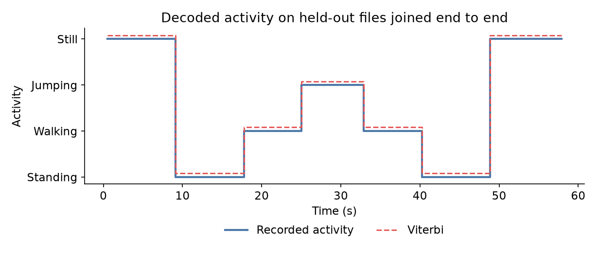

# Activity recognition with a hidden Markov model

A Gaussian HMM, written from scratch in NumPy, that tells standing, walking, jumping, and still apart from a phone's accelerometer and gyroscope. Formative 2, Machine Learning Techniques, African Leadership University.

<p align="center">
  
</p>

## Results

Tested on 40 unseen recordings, 581 one-second windows:

| Activity | Windows | Sensitivity | Specificity | Accuracy |
| --- | ---: | ---: | ---: | ---: |
| Standing | 138 | 1.000 | 1.000 | 1.000 |
| Walking | 134 | 1.000 | 1.000 | 1.000 |
| Jumping | 149 | 1.000 | 1.000 | 1.000 |
| Still | 160 | 1.000 | 1.000 | 1.000 |

All recordings come from one person, phone, and session, so this shows the activities are separable here, not that the model transfers to other people. The [report](report/Formative_2_Hidden_Markov_Models.pdf) and the [notebook](notebooks/hmm_activity_recognition.ipynb) have the details.

## Run it

```bash
git clone https://github.com/supserrr/hidden-markov-models.git
cd hidden-markov-models
python3 -m venv .venv && source .venv/bin/activate
pip install -r requirements.txt
python -m src.experiment
```

This refits the model and writes `results/`. After adding Sensor Logger zips to `data/raw/<activity>/`, run `python -m src.convert` first.

## Data

200 Sensor Logger recordings from one iPhone 16 Pro at 100 Hz: 50 each of standing, walking, jumping, and still, 5.6 to 9.9 seconds long. The last 10 of each activity are the test set. See [data/README.md](data/README.md).

| Activity | 5-second clip | Longer clip, ending on the Sensor Logger screen |
| --- | --- | --- |
| Standing | [standing.mp4](videos/standing.mp4) | [standing_long.mp4](videos/standing_long.mp4) |
| Walking | [walking.mp4](videos/walking.mp4) | [walking_long.mp4](videos/walking_long.mp4) |
| Jumping | [jumping.mp4](videos/jumping.mp4) | [jumping_long.mp4](videos/jumping_long.mp4) |
| Still | [still.mp4](videos/still.mp4) | [still_long.mp4](videos/still_long.mp4) |

## Model

Each observation is nine features from a 1 s window with a 0.5 s hop, on a 50 Hz grid. The size features are log-scaled, then every feature is z-scored on the training data. Each state emits a diagonal Gaussian; Baum-Welch trains the model and Viterbi labels each window.

## Layout

```text
data/        raw zips, processed CSVs, manifest
notebooks/   the full pipeline, with outputs
src/         converter, features, HMM, experiment
results/     figures and metrics
report/      the written report
videos/      data collection clips
```
