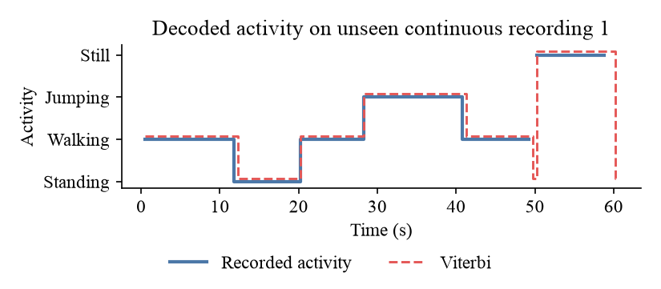

# Activity recognition with a hidden Markov model

A Gaussian HMM, written from scratch in NumPy, that tells standing, walking, jumping, and still apart from a phone's accelerometer and gyroscope. Formative 2, Machine Learning Techniques, African Leadership University.

<p align="center">
  
</p>

## Results

### Unseen session

A second session on the same phone, about 11 hours after the training data: 20 single-activity files and 2 continuous recordings that change activity, 486 scored one-second windows.

| Activity | Windows | Sensitivity | Specificity | Accuracy |
| --- | ---: | ---: | ---: | ---: |
| Standing | 104 | 0.981 | 0.995 | 0.990 |
| Walking | 147 | 0.993 | 0.994 | 0.990 |
| Jumping | 124 | 1.000 | 0.997 | 0.990 |
| Still | 111 | 0.982 | 1.000 | 0.990 |

Five windows are wrong. Three straddle a change of activity in a continuous recording, and two are the first second of one still file, while the phone settled after being put down.

### Held-out files from the training session

The last 10 recordings of each activity: 40 files, 581 windows.

| Activity | Windows | Sensitivity | Specificity | Accuracy |
| --- | ---: | ---: | ---: | ---: |
| Standing | 138 | 1.000 | 1.000 | 1.000 |
| Walking | 134 | 1.000 | 1.000 | 1.000 |
| Jumping | 149 | 1.000 | 1.000 | 1.000 |
| Still | 160 | 1.000 | 1.000 | 1.000 |

Everything comes from one phone, so this shows the activities stay apart across two sessions, not that the model transfers to other people or phones. The [report](report/Formative_2_Hidden_Markov_Models.docx) and the [notebook](notebooks/hmm_activity_recognition.ipynb) have the details.

## Run it

```bash
git clone https://github.com/supserrr/hidden-markov-models.git
cd hidden-markov-models
python3 -m venv .venv && source .venv/bin/activate
pip install -r requirements.txt
python -m src.experiment
```

This refits the model and writes `results/`. After adding Sensor Logger zips to `data/raw/<activity>/`, run `python -m src.convert` first. Zips for a test-only session go in `data/unseen/raw/<activity>/` or `data/unseen/raw/mixed/`, with the activity spans of each mixed one in `data/unseen/segments.csv`.

## Data

200 Sensor Logger recordings from one iPhone 16 Pro at 100 Hz: 50 each of standing, walking, jumping, and still, 5.6 to 9.9 seconds long. The last 10 of each activity are the held-out set. A second session in `data/unseen/` adds 5 files per activity and 2 continuous recordings of about 61 s, used only for testing. See [data/README.md](data/README.md).

| Activity | 5-second clip | Longer clip, ending on the Sensor Logger screen |
| --- | --- | --- |
| Standing | [standing.mp4](videos/standing.mp4) | [standing_long.mp4](videos/standing_long.mp4) |
| Walking | [walking.mp4](videos/walking.mp4) | [walking_long.mp4](videos/walking_long.mp4) |
| Jumping | [jumping.mp4](videos/jumping.mp4) | [jumping_long.mp4](videos/jumping_long.mp4) |
| Still | [still.mp4](videos/still.mp4) | [still_long.mp4](videos/still_long.mp4) |

## Model

Each observation is nine features from a 1 s window with a 0.5 s hop, on a 50 Hz grid. The size features are log-scaled, then every feature is z-scored on the training data. Each state emits a diagonal Gaussian; Baum-Welch trains the model and Viterbi labels each window.

## Layout

```text
data/        raw zips, processed CSVs, manifest, unseen session
notebooks/   the full pipeline, with outputs
src/         converter, features, HMM, experiment
results/     figures and metrics
report/      the written report
videos/      data collection clips
```
